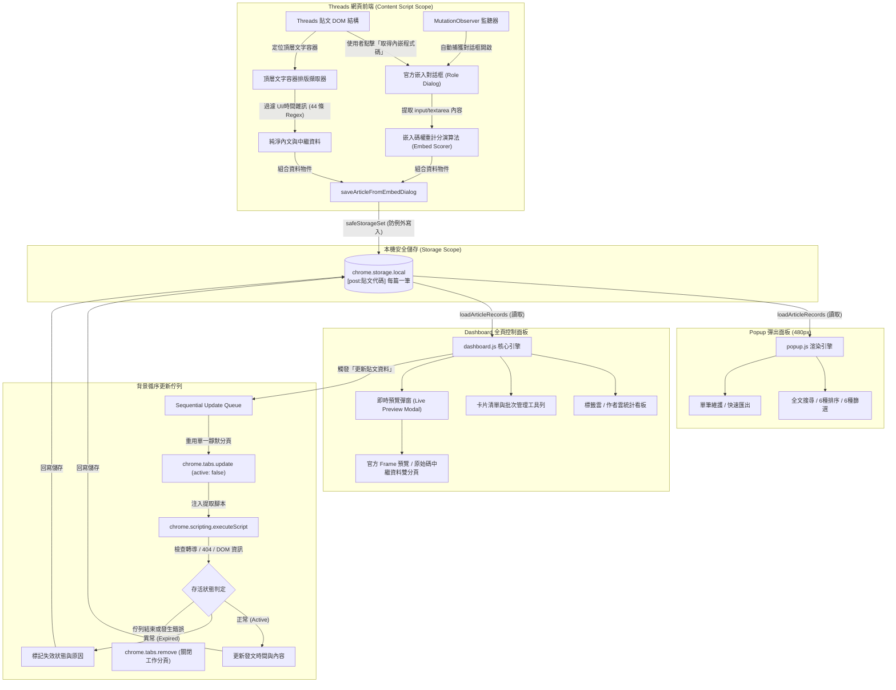
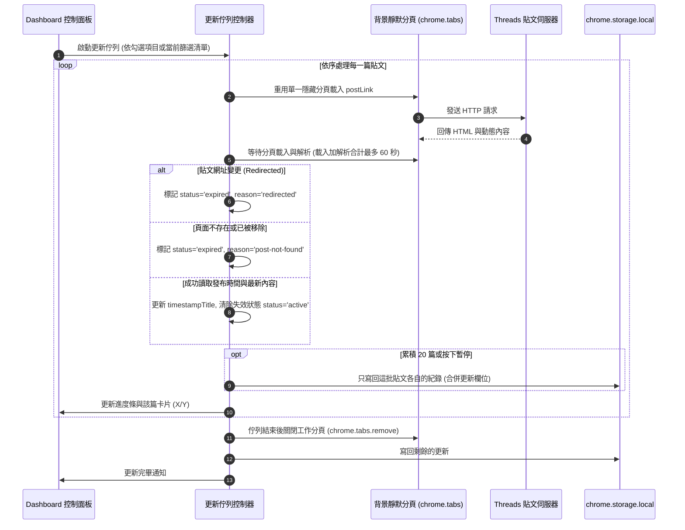
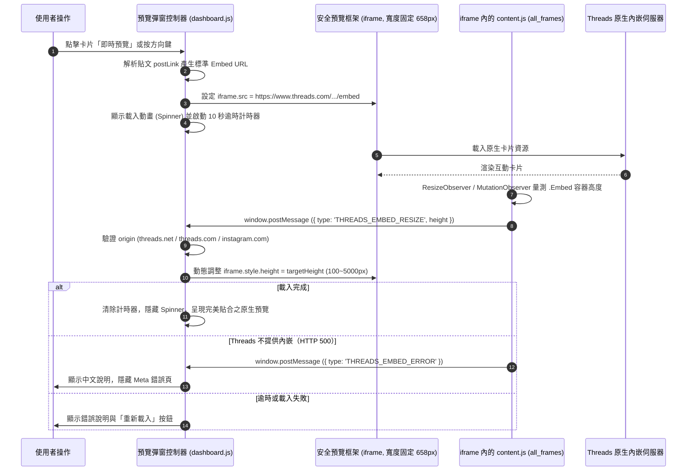

<div align="center">

# Threadkeep

**自動擷取、清理、管理與匯出 Threads 貼文的內嵌碼與中繼資料**

舊名「Threads 程式碼儲存器」(Threads Code Saver)，2.7.0 起改名為 Threadkeep；repo 也從 threads-embedded-code 改名為 Threadkeep

**[前往介紹頁](https://scorpio-meow.github.io/Threadkeep/)**：功能導覽、互動清洗示範與安裝教學

[](https://scorpio-meow.github.io/Threadkeep/)
[](./manifest.json)
[](https://developer.chrome.com/docs/extensions/mv3/intro/)
[](./LICENSE)
[](#技術規格與技術棧)
[](#前置條件與環境需求)
[](#技術規格與技術棧)
[](https://threadfolio.yao921024.workers.dev)

---

基於 Google Chrome Manifest V3 標準設計的輕量級瀏覽器擴充功能。  
純前端架構、零外部依賴。所有資料均安全儲存於瀏覽器本機的 chrome.storage.local，  
無需任何後端伺服器、外部資料庫或第三方 API 金鑰，完整保障您的隱私與資料安全。

</div>

---

## 目錄

- [專案簡介與核心價值](#專案簡介與核心價值)
- [生態系與關聯專案](#生態系與關聯專案)
- [快速開始](#快速開始)
  - [前置條件與環境需求](#前置條件與環境需求)
  - [安裝與載入擴充功能](#安裝與載入擴充功能)
  - [基本操作流程](#基本操作流程)
- [核心功能特性](#核心功能特性)
  - [1. 智慧攔截與安全儲存](#1-智慧攔截與安全儲存)
  - [2. 頂層排版保留與深層文本清洗](#2-頂層排版保留與深層文本清洗)
  - [3. 多維度結構化欄位提取](#3-多維度結構化欄位提取)
  - [4. 控制面板即時預覽 (Live Preview)](#4-控制面板即時預覽-live-preview)
  - [5. 背景循序同步與失效監控佇列](#5-背景循序同步與失效監控佇列)
  - [6. 雙檢視介面與全方位批次操作](#6-雙檢視介面與全方位批次操作)
  - [7. 多維度分類篩選與彈性排序體系](#7-多維度分類篩選與彈性排序體系)
  - [8. 互動式標籤與作者統計雲](#8-互動式標籤與作者統計雲)
  - [9. 智慧容錯匯入與多格式匯出](#9-智慧容錯匯入與多格式匯出)
  - [10. 無障礙設計與可復原操作](#10-無障礙設計與可復原操作)
- [技術規格與技術棧](#技術規格與技術棧)
- [專案目錄與模組架構](#專案目錄與模組架構)
  - [專案檔案結構](#專案檔案結構)
  - [檔案職責對照表](#檔案職責對照表)
- [系統架構與流程圖](#系統架構與流程圖)
  - [整體系統架構圖](#整體系統架構圖)
  - [背景同步與失效恢復流程圖](#背景同步與失效恢復流程圖)
  - [即時預覽安全通訊協定圖](#即時預覽安全通訊協定圖)
- [核心演算法與技術實作細節](#核心演算法與技術實作細節)
  - [1. 頂層文字容器排版擷取演算法](#1-頂層文字容器排版擷取演算法)
  - [2. 嵌入碼對話框權重評分演算法](#2-嵌入碼對話框權重評分演算法)
  - [3. 標籤擷取與正規化](#3-標籤擷取與正規化)
  - [4. 44 條 UI 雜訊與時間過濾鏈](#4-44-條-ui-雜訊與時間過濾鏈)
  - [5. 非同步循序更新佇列與工作分頁架構](#5-非同步循序更新佇列與工作分頁架構)
  - [6. 即時預覽動態高度自適應通訊](#6-即時預覽動態高度自適應通訊)
- [資料模型與儲存 Schema](#資料模型與儲存-schema)
  - [SavedArticle 介面定義](#savedarticle-介面定義)
  - [儲存空間管理](#儲存空間管理)
- [配置與權限宣告](#配置與權限宣告)
  - [權限清單與使用目的](#權限清單與使用目的)
  - [內容安全政策 (CSP) 規範](#內容安全政策-csp-規範)
- [備份、匯出與匯入規範](#備份匯出與匯入規範)
  - [匯出格式對比與規範](#匯出格式對比與規範)
  - [匯出檔案範例](#匯出檔案範例)
  - [智慧匯入解析機制](#智慧匯入解析機制)
- [操作指南與快捷鍵速查](#操作指南與快捷鍵速查)
  - [控制面板即時預覽快捷鍵](#控制面板即時預覽快捷鍵)
  - [儀表板常用操作對照表](#儀表板常用操作對照表)
- [常見問題與疑難排解 (FAQ)](#常見問題與疑難排解-faq)
- [開發與貢獻指南](#開發與貢獻指南)
  - [開發與修改流程](#開發與修改流程)
  - [開發注意事項與架構規範](#開發注意事項與架構規範)
- [版本更新紀錄 (Changelog)](#版本更新紀錄-changelog)
- [AI 友善文件說明 (llms.txt)](#ai-友善文件說明-llmstxt)
- [授權條款與免責聲明](#授權條款與免責聲明)

---

## 專案簡介與核心價值

Threads 內建的「儲存」只能在 Threads 裡回頭翻看。想把喜歡的貼文嵌進自己的網站、整理成清單或留一份備份，就得一篇篇打開「取得內嵌程式碼」複製，再自己記下內文、作者與發文時間。

「**Threadkeep**」為解決此痛點而生，具備以下核心價值：

| 核心價值 | 說明 |
| :--- | :--- |
| **無感自動擷取** | 在貼文選單點「取得內嵌程式碼」，內嵌碼、內文、作者、發文時間與標籤就自動存下，不必另外複製。 |
| **原始排版保真** | 採用頂層文字容器分析演算法，完整保留段落與換行，不會把多行內文壓成一行。 |
| **多層雜訊過濾** | 內建 44 條過濾正規表達式，自動剝離作者簡介、相對發文時間、輪播計數及平台導覽文字。 |
| **本機隱私安全** | 資料 100% 留存於瀏覽器本機儲存區，不會上傳到任何伺服器；對外連線僅限 Threads 官方網域（即時預覽與背景更新）及介面字型所用的 Google Fonts，無追蹤、無遙測。 |
| **靈活跨端複用** | 提供三種匯出，都是內容為 `const posts = [...]` 的 `.js` 檔：「匯出 JS 嵌入代碼」只含內嵌碼（`threads-embed-codes-*.js`），可直接貼進網頁；「匯出精選資料」附上連結、作者、內文與標籤（`threads-featured-data-*.js`），給 Threadfolio 當資料來源；「匯出完整資料」保留發文時間、失效狀態等全部欄位（`threads-full-data-*.js`），用於備份與還原。 |

---

## 生態系與關聯專案

本專案作為「**資料擷取與本機管理中樞**」，與前端展示網站 **[Threadfolio](https://threadfolio.yao921024.workers.dev)** 構成完整的 Threads 內容收藏與公開展示生態系：

| 專案名稱 | 專案定位與職責 | 專案連結 |
| :--- | :--- | :--- |
| **Threadkeep** (本專案) | 瀏覽器擴充功能：負責 Threads 貼文智慧擷取、DOM 雜訊清洗、本機儲存、即時預覽與多格式匯出 | [GitHub 專案庫](https://github.com/Scorpio-meow/Threadkeep) |
| **Threadfolio** (關聯專案) | 前端展示網站：接收本擴充功能匯出的「精選貼文資料 (threads-featured-data-*.js)」，提供響應式卡片流與展示介面 | [Threadfolio 網站](https://threadfolio.yao921024.workers.dev) |

### 雙專案協同運作流程

```
[在 Threads 瀏覽貼文] ──> [Threadkeep (擴充功能)]
                                    │
                                    ▼ (點擊「匯出精選資料」)
                    [產出 threads-featured-data-*.js]
                                    │
                                    ▼ (作為資料來源引用)
                      [Threadfolio 精選貼文網站]
```

1. 在 Threads 看到想留下的貼文時，從貼文選單點「取得內嵌程式碼」，**Threadkeep** 就會把它存進瀏覽器。
2. 於控制面板中點擊「**匯出精選資料**」，擴充功能會自動去除作者帳號 `@` 前綴並格式化為前端配置物件。
3. 將匯出的檔案直接提供給 **[Threadfolio](https://threadfolio.yao921024.workers.dev)** 作為資料來源，即刻完成個人精選貼文網站的更新與展示。

---

## 快速開始

### 前置條件與環境需求

- 支援 Manifest V3 的 Chromium 核心瀏覽器：
  - Google Chrome (版本 88 以上)
  - Microsoft Edge (版本 88 以上)
  - Brave Browser
  - Opera / Opera GX
  - Arc Browser
- 純前端原生專案，不需安裝任何額外編譯環境、執行環境或打包工具。

### 安裝與載入擴充功能

1. 取得專案原始碼：
   ```bash
   git clone https://github.com/Scorpio-meow/Threadkeep.git
   cd Threadkeep
   ```
2. 開啟瀏覽器並進入擴充功能管理頁面：
   - Google Chrome 請於網址列輸入：`chrome://extensions/`
   - Microsoft Edge 請於網址列輸入：`edge://extensions/`
3. 開啟頁面右上角的「**開發人員模式** (Developer mode)」。
4. 點擊左上角的「**載入未封裝項目** (Load unpacked)」。
5. 選取本專案的根目錄（即包含 [manifest.json](./manifest.json) 的資料夾）。
6. 在瀏覽器工具列的擴充功能圖示清單中，將「Threadkeep」釘選至工具列。

### 基本操作流程

```
[瀏覽 Threads 貼文] ──> [點擊「...」選單] ──> [選擇「取得內嵌程式碼」]
                                                    │
                                                    ▼
[資料自動提取並儲存] <── [儲存成功通知浮現] <── [自動攔截嵌入對話框]
        │
        ├──> [點擊工具列圖示] ────> 開啟 Popup 彈出面板 (快速檢索 / 排序 / 篩選 / 匯出)
        │
        └──> [點擊「控制面板」] ──> 開啟全螢幕 Dashboard (即時預覽 / 批次管理 / 標籤雲)
```

---

## 核心功能特性

### 1. 智慧攔截與安全儲存
- **點擊委派與對話框偵測**：在 `document` 以捕獲階段掛一個點擊監聽，只有點到「取得內嵌程式碼」時才擷取貼文內容；`MutationObserver` 只負責在 DOM 變動後（每個畫面影格最多一次）檢查是否出現內嵌對話框，不掃描整頁按鈕。只有在點擊之後，才會每 250ms（`EMBED_DIALOG_POLL_MS`）檢查一次內嵌碼是否出現，最多等 8 秒（`EMBED_DIALOG_TIMEOUT_MS`）。
- **主動式偵測機制**：透過 `processOpenEmbedDialogs` 函式，即使對話框由非擴充功能按鈕開啟，也能自動解析對話框中的唯讀輸入框並儲存。
- **上下文保護封裝**：內建 `safeStorageGet` 與 `safeStorageSet`，自動檢查擴充功能執行環境生命週期 (`isExtensionAlive`)，避免擴充功能更新或重載時拋出未捕獲的 `Extension context invalidated` 例外。

### 2. 頂層排版保留與深層文本清洗
- **原生排版與換行保留**：使用頂層文字容器 `innerText` 擷取策略，完整保留貼文的自然段落換行（`\n`）與 `<br>` 標籤，解決傳統遍歷子節點時將多行內文壓縮為單行空格的問題，並確保同行的 `@提及` 與 `#標籤` 保持排版連貫。
- **UI 與時間雜訊深度過濾**：自動識別並清除作者簡介、追蹤者人數、串文數量、相對時間（如「2天」、「1小時」、「剛剛」）、貼文標頭的「已釘選」「作者」標籤以及各類平台引導文字。目前共 44 條規則，涵蓋繁體中文與英文介面。
- **嚴格排除標頭連結**：精確過濾 `time` 標籤、`a[href*="/post/"]`、`a[href*="/t/"]` 貼文永久連結、`a[href*="/@"]` 作者主頁連結與 `a[href*="/search"]` 主題／熱門話題連結（如「超夯：…」），防止中繼標籤誤混入文章主體。
- **行內貼圖不影響內文**：內文中夾帶的 GIF 貼圖或表情圖片（`aria-hidden="true"` 的 `img`）不會被視為媒體，整段文字照常擷取；只有含影片、`picture`、`canvas` 或一般圖片的容器才會排除。
- **回覆邊界隔離**：在動態牆或個人首頁擷取時，偵測到「回覆...」邊界元素時自動切斷，確保僅擷取發文者所發布的主內容。
- **純圖片說明過濾**：透過 `isLikelyImageOnlyDescription` 智慧判別僅含圖片說明的貼文（如 `Photo by ... on ...`），避免無效擷取。

### 3. 多維度結構化欄位提取
系統會將每篇貼文完整解析為標準化的結構化資料物件：

| 欄位名稱 | 類型 | 說明 |
| :--- | :--- | :--- |
| **貼文內文** | `string` | 經過去除 UI 雜訊與中繼標籤後的純文字（保留完整段落換行） |
| **發文作者** | `string` | 發文者帳號，取自貼文標頭的作者連結文字（通常不含 `@`）；取不到時改用網址中的帳號，仍取不到則為「未知作者」 |
| **發文時間** | `string` | 包含標準 ISO 8601 時間字串與格式化標題文字 |
| **標籤清單** | `string[]` | 結合官方 Hashtag 連結與內文 `#hashtag` 的標籤陣列 |
| **內嵌代碼** | `string` | Threads 官方原生的標準 `<blockquote>` 嵌入代碼 |
| **貼文狀態** | `'active' \| 'expired'` | 標記貼文為正常存取中或已失效 |

### 4. 控制面板即時預覽 (Live Preview)
- **雙分頁即時渲染**：
  - **原生內嵌預覽 (Official Embed)**：遵循 Chrome Manifest V3 與 Threads 官方嵌入規範，透過安全 Frame 直接載入官方即時卡片，呈現完整的互動按鈕與動態樣式。
  - **原始碼與中繼資料 (Embed Code & Metadata)**：直接檢視乾淨的 `<blockquote>` 代碼與貼文中繼屬性對照表格。
- **官方標準寬度與高度自適應**：預覽寬度固定為 Threads 官方標準的 658px；高度由注入至 iframe 的 Content Script 量測 `.Embed` 容器後回報，長短貼文皆精準貼合，不留多餘空白或捲軸。
- **實際載入狀態回饋**：區分「載入中」、「載入逾時（10 秒）」與「載入失敗」三種狀態，逾時或失敗時顯示錯誤說明與「重新載入」按鈕；若該貼文沒有可用連結，則直接提示改看「原始碼與中繼資料」分頁。Threads 不提供內嵌的貼文（`/embed` 回 HTTP 500）會顯示中文說明，不會出現 Meta 的英文錯誤頁。
- **帶著登入狀態預覽**：預覽從 `www.threads.com` 載入，會沿用瀏覽器的 Threads 登入狀態；只開放登入者觀看的貼文（例如被列為敏感內容），登入 Threads 後也能預覽。這類貼文的內嵌碼放到網站上時，只有已登入 Threads、且瀏覽器允許第三方 Cookie 的訪客看得到。
- **全方位快捷鍵與導覽**：支援鍵盤 `ESC` 關閉、左/右方向鍵無縫切換上一篇/下一篇貼文、一鍵複製內嵌碼及直接開啟原文。

### 5. 背景循序同步與失效監控佇列
- **循序非同步更新**：點擊「更新貼文資料」時，系統會依照當前篩選與排序後的結果建立佇列（若已勾選貼文，則僅更新目前篩選結果中被勾選的項目；勾選後又被篩掉的貼文不會更新），並重複使用**同一個背景工作分頁**循序載入，有效避免多開分頁導致的系統卡頓或平台流量限制。
- **寬鬆的安全上限**：每篇的分頁載入與頁面解析合計最多等 60 秒，超過只記為「失敗」、不標記失效，網路較慢的正常貼文不會被誤判；注入腳本以 `MutationObserver` 在頁面渲染時立即檢查（兩次檢查至少間隔 80ms），不受背景分頁的計時器節流影響。
- **分批寫回**：每處理 20 篇、按下暫停或佇列結束時才寫回一次，而且只寫這幾篇各自的紀錄：先讀取它們目前的內容，只覆蓋發文時間、內文、標籤與失效狀態等欄位，期間被刪除的貼文不會被寫回來，在 Threads 新存的貼文也不受影響。進行中只重繪該篇卡片與統計數字，佇列結束後才更新清單篩選與統計雲。
- **進度與中斷控制**：即時顯示「更新中 (X/Y)」進度條與百分比動畫，並提供「**暫停 / 繼續**」與「**取消**」功能按鈕。
- **智慧失效標記與自動恢復**：
  - 若貼文被刪除、轉為私密或發生轉導（`redirected`），系統將自動標記為 `expired` 並記錄原因。
  - 若頁面文字或標題出現不存在或已移除的訊息（例如「此頁面無法使用」「此串文已被移除」「Page Not Found」），將記錄為 `post-not-found`；只是找不到貼文元素時會等到 60 秒上限後記為失敗，不標記失效。
  - 若下次更新時貼文恢復可存取狀態，系統會自動清除失效標籤並恢復為 `active`。
- **內嵌可用性檢查**：每篇在背景分頁裡以同源、不帶 Cookie 的請求打一次 `/embed`，結果寫入 `embeddable` 與 `embeddableCheckedAt`。回 HTTP 500（例如只開放登入者觀看的貼文）記為 `false`，回 200 且含 `.Embed` 記為 `true`；逾時、限流或其他回應不寫入，保留上次的結論。必須在 threads.com 的分頁裡檢查，因為擴充功能頁面跨站請求 `/embed` 只會拿到 Threads 的一般頁面殼。在 Threads 儲存新貼文時，`content.js` 也會在背景檢查一次。

### 6. 雙檢視介面與全方位批次操作
- **Popup 快速面板**：提供即時搜尋、多維度排序、類型篩選、單篇刪除、複製內嵌代碼、資料匯出與匯入功能。
- **Dashboard 全頁儀表板**：全螢幕響應式佈局，具備多欄位卡片展示、統計數據看板、批次操作功能與完整預覽。
- **分批渲染長清單**：清單一次只建立 60 張卡片（Popup 為 30 張），捲到接近底部或按「顯示更多」才載入下一批；卡片上的按鈕事件統一由清單容器委派，Dashboard 卡片另以 `content-visibility: auto` 略過畫面外的排版。
- **跨介面同步**：Popup 與 Dashboard 監聽 `chrome.storage.onChanged`，在 Threads 新存或在另一個介面刪除的貼文會即時反映到清單。事件只帶來有變動的那幾篇；內容和畫面上相同的變動（例如自己寫入引起的事件）會略過，不重複重繪。
- **搜尋範圍**：比對內文、作者、標籤與貼文連結的路徑（`postLink` 去掉網域後的 `/@作者/post/貼文代碼`），可用帳號或貼文代碼找貼文。每篇的搜尋字串在第一次搜尋時建立並快取，排序也先算好每篇的比較值再排序。
- **批次勾選管理**：Popup 與控制面板的「全選」都會勾選目前篩選結果的全部貼文，包含尚未載入的卡片，並支援半選（Indeterminate）狀態顯示；未勾選任何項目時，「更新貼文資料」、「批次複製 Embed 代碼」與「批次刪除」一律維持 `disabled`，滑鼠與鍵盤皆無法觸發。
- **頁內確認 Modal**：破壞性操作（清除全部、覆寫匯入，以及控制面板的單篇與批次刪除）全面改用頁內 Modal 二次確認；Popup 沒有批次刪除，單篇刪除不另外確認，改以「復原」提示補救。兩個介面都完全不使用原生 `confirm()`、`alert()` 與 `prompt()`；這對 Popup 尤其關鍵——原生對話框會在 Popup 失焦時連同 Popup 一併關閉並回傳預設值。

### 7. 多維度分類篩選與彈性排序體系
系統在 Popup 與 Dashboard 均提供 6 種篩選維度與 6 種排序規則：

- **6 種分類篩選模式**：
  - `全部貼文 (all)`: 顯示資料庫中所有貼文。
  - `依作者 (author)`: 二級下拉選單動態列出所有作者，精確篩選特定發文者。
  - `依標籤 (tag)`: 二級下拉選單動態列出所有標籤，精確篩選特定技術主題。
  - `無內文 (noContent)`: 快速找出 `content` 為空的貼文（例如純圖片或未成功擷取內文者），便於集中維護。
  - `無發文時間 (noTimestamp)`: 篩選出未成功擷取官方發布時間或時間戳記與儲存時間異常之項目。
  - `失效貼文 (expired)`: 篩選出被原作者刪除、私密化或轉導的失效貼文。
- **6 種排序規則**：
  - `儲存時間: 新到舊 (savedAt-desc)` / `儲存時間: 舊到新 (savedAt-asc)`
  - `發布時間: 新到舊 (timestamp-desc)` / `發布時間: 舊到新 (timestamp-asc)`
  - `作者名稱: A-Z (author-asc)` / `作者名稱: Z-A (author-desc)`

### 8. 互動式標籤與作者統計雲
- **即時頻次計算**：自動統計所有貼文中的 Top 15 常用標籤與 Top 15 熱門作者。標籤不分大小寫合併計數（`React`、`react` 算同一個），以最常見的寫法顯示，篩選選單與「標籤總數」也依同樣規則合併。
- **點擊即時篩選**：點擊標籤雲或作者雲中的任一徽章，即可快速切換儀表板清單的篩選條件；再次點擊即可取消篩選。

### 9. 智慧容錯匯入與多格式匯出
- **三種專業匯出格式**：簡易版 JS 嵌入碼、精選貼文資料、完整版備份檔案。三者皆會在有勾選項目時**僅匯出勾選的貼文**，未勾選時則匯出目前的篩選結果。
- **雙來源匯入**：Popup 可選擇「選擇檔案」讀取 `.js` / `.json` 備份，或以「貼上內容」直接貼上匯出檔文字；Dashboard 則透過檔案選擇器匯入。
- **雙模式智慧匯入**：
  - **合併資料 (Merge)**：以貼文代碼（儲存 key）比對，略過已存在的貼文，匯入檔內的重複項目也只保留一筆；新貼文依儲存時間（`savedAt`）排入清單。
  - **完全覆寫 (Overwrite)**：清空現有資料庫，以匯入檔案內容完全取代；此模式必須再通過一次「確認完全覆寫」對話框才會執行。
- **兩階段解析**：先以 `JSON.parse` 解析 `const posts = [...]`，失敗時改用正規表達式抽出每段內嵌碼，相容三種匯出格式與標準 JSON 備份。

### 10. 無障礙設計與可復原操作
- **完整 Modal 無障礙語意**：所有對話框均具備 `role="dialog"`、`aria-modal="true"` 與標題關聯，確認與匯入方式對話框另有描述關聯；開啟時自動聚焦、`Tab` 焦點鎖定於對話框內、`ESC` 可關閉，關閉後焦點自動回到觸發按鈕。
- **可復原的刪除與清除**：單篇刪除、批次刪除與清除全部資料後，會顯示帶有「復原」按鈕的提示（預設 8 秒）；滑鼠移到提示上或鍵盤焦點停在「復原」按鈕時暫停倒數。同一時間僅保留一則復原提示，避免舊快照回捲較新的變更。
- **即時語音回饋**：Popup、Dashboard 的 Toast 容器與注入 Threads 頁面的通知皆為 live region。Popup 與 Dashboard 的 Toast 一律為 `role="status"`（錯誤只改變外觀），Threads 頁面上的錯誤通知才改用 `role="alert"`。一般訊息至少顯示 4 秒、錯誤至少 6 秒，較長的訊息依字數延長（每字約 0.12 秒），滑鼠移到提示上時暫停倒數。
- **清楚的焦點外框**：按鈕與連結的鍵盤焦點以 2px 實線外框標示（淺色 `#2563eb`、深色 `#60a5fa`），與周圍背景的對比至少 4.6:1；輸入框與下拉選單改用內圈 2px 實色（`#1d4ed8`／`#93c5fd`，對比至少 6.5:1）加外圈光暈的雙環，高對比模式下改回系統顏色外框。
- **深色與高對比模式**：控制面板右上角的「外觀」選單可選跟隨系統、淺色或深色，設定存在 `chrome.storage.local`，Popup 與 Threads 頁面上的通知一併套用；顏色集中定義在 `:root` 的 CSS 變數；Windows 高對比模式（`forced-colors`）下，焦點外框、勾選框、選取狀態與進度條改用系統顏色標示。
- **可操作的標籤與作者徽章**：統計雲徽章由 `span` 改為 `button` 並標註 `aria-pressed`，可用鍵盤聚焦並切換篩選狀態。
- **螢幕閱讀器結構**：貼文卡片是清單項目、作者名稱是標題；卡片的勾選框與操作按鈕名稱帶上作者與發文時間（例如「刪除：user174 於 18 小時前發布的貼文」），相對時間另附完整日期時間。搜尋、篩選與勾選後會朗讀結果數量（「找到 5 篇貼文」「已選取 3 篇」）。
- **焦點不遺失**：點徽章篩選、刪除、復原或背景更新重畫卡片後，焦點留在原控制項，或移到同一位置的下一篇、還原的那篇，不會跳回頁首。
- **視覺與動態友善**：文字對比度提升至 4.5:1，偏小的按鈕點擊目標放大至 24×24px 以上（勾選框例外，見 [ACCESSIBILITY.md](./ACCESSIBILITY.md) 的已知限制），字級下限拉高到 12px；三份樣式表皆支援 `prefers-reduced-motion: reduce`，在系統要求減少動態時停用轉場動畫。
- **輸入防抖**：兩個介面的搜尋框皆加入 180ms debounce，資料量大時輸入不再卡頓。

> [!NOTE]
> 無障礙目標、已知限制（例如即時預覽的卡片由 Meta 決定）與障礙回報方式，請見 [ACCESSIBILITY.md](./ACCESSIBILITY.md)。

---

## 技術規格與技術棧

```
+-----------------------------------------------------------------------+
|                             技術架構標準                              |
+-----------------------------------------------------------------------+
|  規範標準    | Chrome Extensions Manifest V3                          |
|  核心語言    | 原生 JavaScript (ES6+), HTML5, CSS3 Variables          |
|  依賴套件    | 無 npm 套件 (介面字型由 Google Fonts 載入)             |
|  資料儲存    | 瀏覽器本機儲存 (chrome.storage.local，以 unlimitedStorage 解除 10MB 配額)   |
|  安全規範    | 符合嚴格 CSP (Content Security Policy)，無行內事件與樣式 |
|  相容平台    | Google Chrome, Microsoft Edge, Brave, Opera, Arc 等    |
|  建置流程    | 零編譯步驟 (Zero-build step, 開箱即用)                |
+-----------------------------------------------------------------------+
```

---

## 專案目錄與模組架構

### 專案檔案結構

```
Threadkeep/
├── manifest.json         # 擴充功能設定檔 (Manifest V3 權限與腳本規則)
├── article-store.js      # 共用儲存層 (每篇一個 key、舊資料搬移、跨介面同步、標籤合併)
├── theme.js              # 外觀設定 (跟隨系統／淺色／深色，Popup 與控制面板共用)
├── content.js            # Content Script (DOM 監聽、對話框攔截、文本清洗、資料提取)
├── styles.css            # 注入至 Threads 網頁的通知提示樣式
├── popup.html            # 瀏覽器工具列彈出視窗 HTML
├── popup.css             # 彈出視窗樣式表 (淺色／深色主題、響應式清單)
├── popup.js              # 彈出視窗控制邏輯 (搜尋、排序、篩選、頁內 Modal、匯出、匯入)
├── dashboard.html        # 完整管理儀表板 HTML (包含即時預覽彈窗、統計看板、批次工具列)
├── dashboard.css         # 儀表板樣式表 (Grid 排版、預覽彈窗、動畫轉場、動態降級)
├── dashboard.js          # 儀表板控制邏輯 (統計雲、預覽控制器、循序佇列、批次處理、復原機制)
├── icons/                # 擴充功能圖示 (16、32、48、128 px)
├── images/               # 空狀態用的吉祥物圖 (mascot-320.webp)
├── docs/                 # GitHub Pages 介紹頁 (index.html、互動清洗示範、介面截圖與 assets/video/ 操作示範影片)
├── llms.txt              # AI 友善架構與 RAG 快速索引規範文件
├── README.md             # 專案說明文件 (本檔案)
├── CHANGELOG.md          # 版本更新紀錄 (Keep a Changelog 格式)
├── CONTRIBUTING.md       # 貢獻指南
├── CODE_OF_CONDUCT.md    # 貢獻者行為準則
├── SECURITY.md           # 安全政策與漏洞回報方式
├── ACCESSIBILITY.md      # 無障礙聲明
├── LICENSE               # MIT 授權條款
└── .github/              # Issue 範本 (ISSUE_TEMPLATE/) 與 Pull Request 範本
```

### 檔案職責對照表

| 檔案路徑 | 模組層級 | 主要職責與實作內容 |
| :--- | :--- | :--- |
| `manifest.json` | 設定層 | 聲明 Manifest V3 規格、儲存與分頁權限、主機比對規則與 CSP 配置。 |
| `article-store.js` | 儲存層 | 由 content script、Popup 與 Dashboard 共用：決定每篇貼文的儲存 key、搬移舊版 `savedArticles` 陣列、逐篇讀寫與刪除、合併批次更新欄位、把 `chrome.storage.onChanged` 的逐篇變動套用到清單，以及不分大小寫合併標籤統計（`getTagGroups`）。另外存放外觀設定的儲存 key（`THEME_PREFERENCE_KEY`），以及內嵌可用性檢查的共用函式（`getThreadsEmbedPath`、`checkEmbeddable`、`applyEmbeddableResult`、`pickEmbeddableFields`）。 |
| `theme.js` | 外觀層 | 由 Popup 與控制面板在 `<head>` 載入：先以 `localStorage` 的快取立即套用 `data-theme`，避免載入時閃爍，再讀取 `chrome.storage.local` 的 `themePreference` 並同步各頁面；控制面板的「外觀」選單也由它處理。 |
| `content.js` | 注入腳本層 | 負責監聽 Threads DOM 變化、攔截內嵌對話框、頂層排版提取與正規表達式文本清洗，並在 Threads 頁面顯示儲存結果通知、儲存後於背景檢查內嵌可用性；在預覽用的 `/embed` iframe 裡則改為回報卡片高度與載入錯誤給控制面板。 |
| `styles.css` | 注入樣式層 | 定義顯示於 Threads 頁面之儲存成功/失敗浮動通知外觀、進場動畫、`prefers-reduced-motion` 降級，以及深色與高對比模式樣式。 |
| `popup.html` / `popup.js` | 快速檢視層 | 提供 480px 寬度的工具列快速面板，支援即時關鍵字查詢、6 種分類、6 種排序、單篇維護、頁內確認／匯入 Modal 與基本匯出。 |
| `dashboard.html` / `dashboard.js` | 完整管理層 | 全螢幕資料庫中心，提供 Live Preview 即時預覽、批次管理、標籤/作者統計雲、背景更新佇列與可復原的刪除操作。 |
| `llms.txt` | 規範說明層 | 提供 AI 代理與 RAG 檢索系統快速索引之結構化摘要說明文件。 |
| `README.md` | 完整文檔層 | 專案主要說明文件，包含完整系統架構、演算法剖析、資料 Schema 與常見問題。 |
| `CHANGELOG.md` | 完整文檔層 | 各版本的新增、改善、修正與移除項目，格式遵循 Keep a Changelog。 |
| `docs/` | 介紹頁層 | GitHub Pages 介紹頁，不隨擴充功能載入。互動清洗示範由 `assets/js/cleaner-worker.js` 在 Web Worker 中從 `main` 分支載入 `content.js`，直接呼叫 `cleanExtractedPostContent` 與 `isLikelyThreadsFallbackDescription`；更名或移除這兩個函式會讓示範失效。頁面上的版本資訊同樣從 `main` 分支的 `manifest.json` 讀取。 |

---

## 系統架構與流程圖

### 整體系統架構圖



### 背景同步與失效恢復流程圖



### 即時預覽安全通訊協定圖



---

## 核心演算法與技術實作細節

### 1. 頂層文字容器排版擷取演算法

為避免抓取到的內文換行被過度壓平，`content.js` 採用頂層文字容器鎖定策略：

1. **定位候選容器**：選取 `span[class*="xo1l8bm"][dir="auto"]`、`span[class*="xi7mnp6"][dir="auto"]` 與 `div[class*="x1iorvi4"][dir="auto"]` 等主內容區塊。
2. **嚴格過濾時間與標頭節點**：
   - 排除 `time` 標籤本身及其父容器（`closest('time') || querySelector('time')`）。
   - 排除貼文固定網址標籤（`a[href*="/post/"]`、`a[href*="/t/"]`）。
   - 排除純作者標頭連結（`a[href*="/@"]`）。
   - 排除主題標籤與熱門話題連結（`a[href*="/search"]`）。
   - 排除含媒體的容器，但內文裡 `aria-hidden="true"` 的行內貼圖與表情圖片不算媒體。
   - 排除 Meta AI 引導文案與輪播指示器。
   - 單篇貼文頁的 `threads_post_page_0` 只在有文字時才當作搜尋範圍；Threads 目前把它渲染成空的佔位元素，目標貼文改由永久連結定位。
3. **頂層去重 (Top-level Deduplication)**：僅保留未被其他候選容器包含的最頂層容器，防止子節點文字重複提取。
4. **原生排版輸出**：沒有可用的 `threads_post_page_0` 範圍時（目前一律如此），以第一個「回覆…」容器為界，只保留它之前的候選容器。每個頂層容器先複製一份，移除翻譯、「查看原文」與雜訊按鈕後再讀 `innerText`，保留 `<br>` 與天然段落換行。各段經 `cleanExtractedPostContent` 清洗，丟掉整段都是雜訊的內容與重複段落，以 `\n\n` 拼接後再整體清洗一次。

```javascript
const beforeReply = replyBoundary
  ? candidateContainers.filter(el =>
    el.compareDocumentPosition(replyBoundary) & Node.DOCUMENT_POSITION_FOLLOWING
  )
  : candidateContainers;
const topContainers = beforeReply.filter(el =>
  !beforeReply.some(other => other !== el && other.contains(el))
);
const candidates = topContainers
  .map(el => {
    const clone = el.cloneNode(true);
    const childButtons = clone.querySelectorAll('button, [role="button"]');
    for (const btn of childButtons) {
      const btnText = (btn.innerText || btn.textContent || '').trim();
      if (
        isLikelyThreadsFallbackDescription(btnText) ||
        /^(?:查看|隱藏)?翻譯$/i.test(btnText) ||
        /^(?:See|Hide)?\s*translation$/i.test(btnText) ||
        /^查看原文$/i.test(btnText)
      ) {
        btn.remove();
      }
    }
    return (clone.innerText || clone.textContent || '').trim();
  })
  .map(text => cleanExtractedPostContent(text))
  .filter(text => text && !isLikelyThreadsFallbackDescription(text))
  .filter((text, index, array) => array.indexOf(text) === index);
return cleanExtractedPostContent(candidates.join('\n\n'));
```

### 2. 嵌入碼對話框權重評分演算法

當 Threads 彈出嵌入對話框時，頁面可能存在多個唯讀欄位（如純連結或短網址）。`extractEmbedCodeFromDialog` 對所有輸入框進行權重評分：

```javascript
let score = value.length;
if (/data-text-post-permalink=/i.test(value)) score += 1000;
if (/<blockquote/i.test(value)) score += 500;
if (/threads\.com/i.test(value)) score += 100;
```
最後挑選分數最高的內容作為最佳的 `embedCode`，確保 100% 取得包含完整 `blockquote` 的標準內嵌碼。

### 3. 標籤擷取與正規化

`extractTags` 由兩個來源合併標籤，最後統一正規化並去重：

1. **官方 Hashtag 連結**：掃描貼文容器中的 `a[href*="serp_type=tags"]` 與 `a[href*="tag_id="]`，優先取網址中的 `q` 查詢參數，取不到時才退回連結文字，並去除開頭的 `#`。
2. **內文 Hashtag**：以 `#` 或全形 `＃` 開頭、由任何語言的文字、數字或底線組成，而且至少含一個文字的詞，例如 `#台南美食`、`#ラーメン`、`#라면`、`#café`、`#2024台南燈會`。規則為 `/(?<![\p{Script=Latin}\p{Script=Greek}\p{Script=Cyrillic}\p{N}\p{M}_&\/])[#＃](?![\uFE0F\u20E3])([\p{L}\p{M}\p{N}_]*\p{L}[\p{L}\p{M}\p{N}_]*)/gu`，掃描前會先移除 `http://`、`https://` 與 `www.` 開頭的網址。`#` 前面緊接拉丁、希臘或西里爾字母、數字、底線、`&` 或 `/` 時不算，因此 `example.com/docs#install`、`C#12`、`&#39;` 都不會變成標籤；純數字的 `#1`、`#2024` 與鍵帽表情符號 `#️⃣` 也不算。`#` 前面是中日韓字元時（例如「去吃#台南美食」）照樣算。
內文沒有 `#` 的詞不會變成標籤。2.7.0 起移除了原本的技術關鍵字映射，它會依內文補上 JavaScript、Python 等 12 個標籤，詳見 [CHANGELOG.md](./CHANGELOG.md)。

最後以 `String.prototype.normalize('NFC')` 統一 Unicode 表示法，再不分大小寫去重並保留第一次出現的寫法，避免同一個中文標籤因組合字元差異而重複計數，也避免官方連結的 `JavaScript` 和內文的 `#javascript` 同時出現。

> [!NOTE]
> 背景更新佇列注入的 `extractPostInfoFromPage` 不另外保留擷取邏輯，而是直接呼叫 Threads 頁面上 `content.js` 的 `findPostElementFromPostLink`、`extractPostContent` 與 `extractTags`，因此「更新貼文資料」抓到的內文與標籤和存檔時一致。

### 4. 44 條 UI 雜訊與時間過濾鏈

擷取到的原始文字會先經過 `cleanExtractedPostContent` 逐行處理（正規化空白、剝除輪播計數與翻譯按鈕、壓縮多餘空行），再由 `isLikelyThreadsFallbackDescription` 以 44 條正規表達式逐行比對，命中即整行剔除：

```javascript
function isLikelyThreadsFallbackDescription(text) {
  const normalizedText = String(text).replace(/\s+/g, ' ').trim();
  return [
    /\d[\d,.]*\s*(?:萬|千)?次?瀏覽/i,
    /^回覆[\s\S]*[…\.]{1,3}$/i,
    /^尚無回覆$/i,
    /^查看動態$/i,
    /^更多$/i,
    /^返回$/i,
    /^直欄標題$/i,
    /^附加影音內容$/i,
    /^新增 GIF$/i,
    /^展開撰寫工具$/i,
    /^分享$/i,
    /^轉發$/i,
    /^讚$/i,
    /^為你推薦$/,
    /^新串文$/,
    /^搜尋$/,
    /^動態$/,
    /^個人檔案$/,
    /^聯邦宇宙$/,
    /^洞察報告$/,
    /^已儲存$/,
    /^追蹤中$/,
    /^追蹤$/,
    /^已追蹤$/,
    /^(?:已釘選|Pinned)$/i,
    /^(?:作者|Author)$/i,
    /^[·•]$/,
    /^(?:查看|隱藏)?翻譯$/i,
    /^(?:See|Hide)?\s*translation$/i,
    /^查看原文$/i,
    /^附帶原始貼文的回覆內容$/,
    /\d[\d,.]*\s*位粉絲\s*•\s*\d[\d,.]*\s*則串文/i,
    /\d[\d,.]*\s*followers\s*•\s*\d[\d,.]*\s*threads/i,
    /查看\s*@.+\s*參與的最新對話/i,
    /See\s*what\s*@.+\s*is\s*saying\s*on\s*Threads/i,
    /在貼文中提及\s*@meta\.ai\s*，即可在這裡獲得解答/i,
    /^\d+\s*(?:秒|分|分鐘|小時|天|週|年|s|m|h|d|w|y)(?:前)?$/i,
    /^\d{1,2}\s*月\s*\d{1,2}\s*日$/i,
    /^\d{4}\s*年\s*\d{1,2}\s*月\s*\d{1,2}\s*日$/i,
    /^[A-Z][a-z]{2}\s+\d{1,2}(?:,\s*\d{4})?$/i,
    /^(?:剛剛|昨天|前天|yesterday|just now)$/i,
    /^\d+\s*[\/／]\s*\d+(?:\s*[•·]\s*[\u4e00-\u9fa5\w]+)?$/i,
    /^\d+\s*(?:of|之)\s*\d+$/i,
    /^(?:圖片|相片|photo|image)\s*\d+\s*[\/／,，共of\s]+\d+(?:\s*張)?$/i
  ].some(pattern => pattern.test(normalizedText));
}
```

### 5. 非同步循序更新佇列與工作分頁架構

在 `dashboard.js` 中，貼文更新採用**單一可重用工作分頁**的循序控制迴圈，並於每一輪開頭檢查「取消」與「暫停」訊號：

```javascript
for (const article of articlesNeedingUpdate) {
  if (cancelUpdateRequested) break;
  if (isUpdatePaused) await flushPendingUpdates();                 // 暫停前先寫回已完成的部分
  while (isUpdatePaused && !cancelUpdateRequested) {
    await new Promise(resolve => setTimeout(resolve, 150)); // 暫停中等待恢復
  }
  if (cancelUpdateRequested) break;

  const tabId = await getOrCreateWorkerTab();                      // 重用同一個背景分頁
  const postInfo = await fetchPostInfoWithReusableTab(tabId, article.postLink); // 最多等 60 秒
  if (postInfo && postInfo.status === 'expired') {
    markArticleAsExpired(article, postInfo.reason);                // redirected / post-not-found / fallback-summary
  } else if (postInfo) {
    clearArticleExpiredStatus(article);                            // 貼文復活則清除失效標記
    // 寫回 timestamp、timestampTitle、content 與 tags
  }
  pendingArticles.add(article);
  if (pendingArticles.size >= UPDATE_PERSIST_BATCH_SIZE) await flushPendingUpdates(); // 每 20 篇合併寫回
  refreshRenderedCard(article);                                    // 只重繪這一張卡片
}
// finally：關閉工作分頁、寫回剩餘的更新，再整體重繪清單與統計雲
```

- **分批合併寫回**：`flushPendingUpdates` 呼叫 `mergeArticleUpdates`，只讀取這批貼文各自的 key，把 `ARTICLE_UPDATE_FIELDS`（`timestamp`、`timestampTitle`、`content`、`tags`、失效狀態、`timestampUpdatedAt`、`embeddable`、`embeddableCheckedAt`）以記憶體中的值套到目前儲存的紀錄上再寫回，記憶體中沒有的欄位會從紀錄刪除；已不存在的 key 代表貼文在佇列期間被刪除，會直接略過。中途關閉頁面最多遺失最後未寫回的 19 篇更新結果，重新執行即可補上。
- **分頁生命週期**：工作分頁僅在擷取失敗或整個佇列結束（`finally`）時關閉，其餘時間重複使用，避免反覆開關分頁的成本。
- **安全上限**：`fetchPostInfoWithReusableTab` 以 60 秒（`POST_FETCH_TIMEOUT_MS`）為上限，涵蓋分頁載入與頁面解析；逾時回傳 `null`，記為失敗並關閉工作分頁，不會標記為失效。注入頁面的解析器以 `MutationObserver` 觸發檢查，兩次檢查至少間隔 80ms（`POST_INFO_CHECK_INTERVAL_MS`）。

### 6. 即時預覽動態高度自適應通訊

Threads 官方 `/embed` 頁面只會對父視窗送出一個不帶型別的數字字串，無法和其他訊息區分，因此本擴充功能透過 `manifest.json` 的 `all_frames: true` 將 `content.js` 一併注入預覽 iframe。當腳本偵測到自己位於 `/embed` 或非頂層框架時，改走 `handleEmbedFrameResize()` 分支：以 `ResizeObserver` 觀測 `.Embed` 容器與 `body` 的第一個子元素，容器被替換時由只看節點增減的 `MutationObserver` 重新掛上觀測。量測合併到每個畫面影格最多一次，高度有變化才將量得的高度回傳父視窗：

```javascript
window.parent.postMessage({ type: 'THREADS_EMBED_RESIZE', height: h }, parentOrigin);
```

Threads 不提供內嵌的貼文（已刪除、不公開，或只開放登入的使用者觀看，例如被列為敏感內容），`/embed` 會回 HTTP 500 與 Meta 的錯誤頁；這類貼文的內嵌碼放到網站上，未登入 Threads 或封鎖第三方 Cookie 的訪客同樣顯示不出來。預覽從 `www.threads.com` 載入，會帶著瀏覽器的 Threads 登入狀態，所以只開放登入者觀看的貼文在已登入時可以正常預覽。iframe 一樣會觸發 `load`，所以 `content.js` 在 `/embed` 頁找不到 `.Embed` 容器時改送 `{ type: 'THREADS_EMBED_ERROR' }`。儀表板確認訊息來自目前的預覽 iframe 後，顯示自己的錯誤提示並隱藏錯誤頁，之後的 `load` 事件也不會再把狀態改回「已載入」。

`content.js` 會注入所有 threads.com 框架，包括其他網站嵌入的 Threads iframe，但只有在直接父視窗是本擴充功能的頁面時才送訊息：以 `location.ancestorOrigins[0]` 的 host 比對 `chrome.runtime.id`，相符才送出，而且 `postMessage` 只指定該來源，不用 `'*'`。其他網站嵌入的 Threads iframe 不會收到 `THREADS_EMBED_RESIZE` 或 `THREADS_EMBED_ERROR`，也就看不出瀏覽器裝了本擴充功能。

儀表板端先驗證來源網域；`THREADS_EMBED_ERROR` 只在 `event.source` 是目前的預覽 iframe 時才處理。高度依序取 `THREADS_EMBED_RESIZE` 的 `height`、官方 `MEASURE` 等格式的 `details.height`（字串會先解析成 JSON），再退回 `height` 或 `scrollHeight`，只套用 100–5000px 之間的值：

```javascript
function isAllowedEmbedOrigin(origin) {
  if (!origin) return false;
  try {
    const url = new URL(origin);
    const hostname = url.hostname.toLowerCase();
    const allowedDomains = ['threads.net', 'threads.com', 'instagram.com'];
    return allowedDomains.some(domain => hostname === domain || hostname.endsWith('.' + domain));
  } catch (_) {
    return false;
  }
}

window.addEventListener('message', (event) => {
  if (!isAllowedEmbedOrigin(event.origin)) return;
  let data = event.data;
  if (typeof data === 'string') {
    try { data = JSON.parse(data); } catch (_) { }
  }
  const iframe = document.getElementById('previewIframe');
  if (data && data.type === 'THREADS_EMBED_ERROR') {
    if (iframe && event.source === iframe.contentWindow) {
      clearTimeout(previewLoadTimer);
      setPreviewState('error', '…');
    }
    return;
  }
  if (!data || typeof data !== 'object') return;

  let details = data.details;
  if (typeof details === 'string') {
    try { details = JSON.parse(details); } catch (_) { }
  }
  let targetHeight = 0;
  if (data.type === 'THREADS_EMBED_RESIZE' && data.height) {
    targetHeight = Number(data.height);
  } else if (details && details.height) {
    targetHeight = Number(details.height);
  } else if (data.height) {
    targetHeight = Number(data.height);
  } else if (data.scrollHeight) {
    targetHeight = Number(data.scrollHeight);
  }
  if (targetHeight > 100 && targetHeight < 5000 && iframe) {
    iframe.style.height = `${targetHeight}px`;
  }
});
```

---

## 資料模型與儲存 Schema

每篇貼文是一個 `SavedArticle` 物件，各自存在 `chrome.storage.local` 的一個 key 底下。key 為 `post:` 加上貼文網址中的貼文代碼（例如 `post:DezKX7tE_q9`）；沒有可辨識連結的匯入資料改用 `post:id:<id>`。同一篇貼文（包括 threads.com 與 threads.net 的網址）會對應到同一個 key，再存一次會覆蓋整筆紀錄，但保留先前的 `embeddable`／`embeddableCheckedAt`，並在背景重新檢查一次。各介面讀取後依 `savedAt` 由新到舊排列。

> [!NOTE]
> 2.2.1 以前的版本把所有貼文存成 `savedArticles` 鍵裡的一個陣列。新版第一次開啟 Popup、控制面板或在 Threads 存檔時，會把舊陣列拆成逐篇紀錄：只寫入尚未存在的 key（不覆蓋較新的紀錄），同一篇的重複紀錄保留陣列中較前面（較新）的那筆，讀回確認全部寫入後才刪除 `savedArticles`。搬移後改裝舊版會讀不到資料，若需要降版，請先匯出完整備份再匯入。

### SavedArticle 介面定義

```typescript
interface SavedArticle {
  /** 唯一主鍵識別碼 (新儲存為 embed_[時間戳]_[隨機字串]；匯入資料為 imported_[時間戳]_[隨機字串]，來源檔已有 id 則沿用) */
  id: string;

  /** 貼文原始 URL，作為去重與更新的主鍵 */
  postLink: string;

  /** Threads 官方原生 <blockquote> HTML 內嵌碼 */
  embedCode: string;

  /** 發布時間 (ISO 8601 標準格式) */
  timestamp: string;

  /** 格式化發布時間標題 (例如: "2026年5月29日 上午10:00") */
  timestampTitle: string;

  /** 儲存至本機資料庫的時間 (ISO 8601) */
  savedAt: string;

  /** 貼文純文字內容 (已保留段落換行並清除 UI 雜訊) */
  content: string;

  /** 發文者帳號，取自作者連結文字 (通常不含 @，如 "username")；取不到時用網址中的帳號，否則為「未知作者」 */
  author: string;

  /** 分類標籤清單 (官方 Hashtag 連結與內文 #hashtag) */
  tags: string[];

  /** 貼文存活狀態 */
  status: 'active' | 'expired';

  /** 標記為失效的時間 (ISO 8601) */
  expiredAt?: string;

  /** 失效具體原因 */
  expiredReason?: 'redirected' | 'post-not-found' | 'fallback-summary' | 'unknown';

  /** 最後一次檢查存活狀態的時間 (ISO 8601) */
  expiredCheckedAt?: string;

  /** 發布時間戳記最後更新時間 (ISO 8601) */
  timestampUpdatedAt?: string;

  /** 不帶 Cookie 時 Threads 是否提供內嵌卡片：/embed 回 HTTP 500 為 false，回 200 且含 .Embed 為 true；從未得出結論時不存在，之後的檢查沒有結論時保留上次的值 */
  embeddable?: boolean;

  /** 最後一次得出 embeddable 結論的時間 (ISO 8601) */
  embeddableCheckedAt?: string;

  /** 匯入來源標記，只有 Popup 匯入 .js 檔時寫入；控制面板匯入與 .json 匯入不寫入 */
  importedFrom?: 'full-data-file' | 'js-embed-file';
}
```

> [!NOTE]
> 自 v2.1.0 起，`codeBlocks` 與 `codeCount` 欄位已移除。相關抽取邏輯在舊版儲存流程被嵌入對話框攔截取代後即未再接線，新資料一律為空陣列；匯入舊備份時也不會再保留這兩個欄位，程式碼內容亦不再納入搜尋範圍。自 v2.2.1 起，搜尋比對 `content`、`author`、`tags` 與 `postLink` 的路徑部分（不含網域）；先前比對的 `embedCode` 大多是固定的官方樣板（SVG 與行內樣式），搜尋「threads」之類的字會命中所有貼文。

### 儲存空間管理

- **儲存配額**：Chromium `chrome.storage.local` 預設配額為 **10MB**，每篇貼文含官方內嵌碼約 3–4 KB，約兩、三千篇就會用完。本擴充功能宣告 `unlimitedStorage` 權限解除這個上限，實際容量取決於磁碟空間。
- **逐篇寫入**：在 Threads 存一篇只寫入那一篇（約 3–4 KB），刪除只移除對應的 key，不必讀寫全部資料；開啟 Popup 或控制面板時仍會一次讀取全部貼文。
- **寫入失敗提示**：若儲存時仍發生錯誤，系統會自動彈出提示。建議定期將資料匯出為「完整版資料備份檔案」並清理不必要的舊資料。

---

## 配置與權限宣告

### 權限清單與使用目的

本擴充功能嚴格遵循最小權限原則（Principle of Least Privilege），僅宣告達成功能所需之必要權限：

| 權限項目 | 權限類型 | 宣告用途與安全說明 |
| :--- | :--- | :--- |
| `storage` | API 權限 | 讀取與寫入本機 `chrome.storage.local` 資料庫。 |
| `unlimitedStorage` | API 權限 | 解除 `chrome.storage.local` 的 10MB 配額，收藏數千篇貼文時不會寫入失敗；Chrome 安裝時不會因此顯示額外的權限警告。 |
| `tabs` | API 權限 | 在背景建立靜默分頁以執行「更新貼文資料」與失效檢查。 |
| `scripting` | API 權限 | 向背景載入的 Threads 分頁動態注入資訊擷取腳本。 |
| `https://www.threads.com/*` | 主機權限 | 允許在標準 Threads 網域注入 Content Script 並讀取貼文內容。 |
| `https://threads.com/*` | 主機權限 | 允許在非 www 前綴的 Threads 網域執行相同操作。 |
| `https://www.threads.net/*` | 主機權限 | 支援透過官方 threads.net 網域載入即時預覽 Frame 與發文時間同步。 |
| `https://threads.net/*` | 主機權限 | 支援非 www threads.net 網域主機權限。 |

### 內容安全政策 (CSP) 規範

```json
"content_security_policy": {
  "extension_pages": "script-src 'self'; object-src 'self'; frame-src https://www.threads.com https://www.threads.net https://*.threads.com https://*.threads.net;"
}
```
- **禁止外部腳本**：所有頁面僅載入本機自帶之腳本（`script-src 'self'`），不載入任何外部 CDN 腳本或遠端代碼；唯一的外部資源是 `popup.css`、`dashboard.css` 以 `@import` 引入的 Google Fonts 字型樣式表。
- **安全 Frame 來源**：僅限定允許嵌入來自 Threads 官方網域（`threads.com` 與 `threads.net`）之 iframe 預覽元件。

---

## 備份、匯出與匯入規範

### 匯出格式對比與規範

三種匯出皆以「目前的選取狀態」決定範圍：**有勾選貼文時僅匯出勾選項目**，未勾選時則匯出當前篩選與排序後的清單。

| 格式名稱 | 匯出檔案名稱規範 | 格式結構 | 適用情境與特點 |
| :--- | :--- | :--- | :--- |
| **簡易版嵌入碼 (Embed Only)** | `threads-embed-codes-YYYY-MM-DD.js` | `const posts = ['<blockquote>...</blockquote>', ...];` | 專為靜態網頁快速引用設計，已自動移除重複的 script 標籤並轉義引號。 |
| **精選貼文資料 (Featured Data)** | `threads-featured-data-YYYY-MM-DD.js` | `const posts = [{ embedCode, postLink, author, content, tags, embeddable?, embeddableCheckedAt? }, ...];` | 專為關聯專案 [Threadfolio](https://threadfolio.yao921024.workers.dev) 設計，author 欄位自動去除 `@` 前綴以利作為 Key 或展示標籤使用。檢查過內嵌可用性的貼文才帶 `embeddable` 與 `embeddableCheckedAt`；網站只在 `embeddable === false` 且 iframe 載入失敗時改顯示「只限登入者觀看」的說明。 |
| **完整版備份資料 (Full Data)** | `threads-full-data-YYYY-MM-DD.js` | `const posts = [{ embedCode, postLink, author, content, timestamp, timestampTitle, savedAt, tags, status, ... }, ...];` | 包含內文、時間、標籤、失效狀態與內嵌可用性（檢查過才有）等欄位，適用於跨裝置備份、資料遷移與災難還原。不含 `id`，匯入時會重新產生。 |

### 匯出檔案範例

#### 1. 簡易版嵌入碼 (threads-embed-codes-YYYY-MM-DD.js)
```javascript
const posts = [
    '<blockquote class="text-post-media" data-text-post-permalink="https://www.threads.com/@user/post/abc123xyz">...</blockquote>',
    '<blockquote class="text-post-media" data-text-post-permalink="https://www.threads.com/@developer/post/def456uvw">...</blockquote>'
];
```

#### 2. 精選貼文資料 (threads-featured-data-YYYY-MM-DD.js)
```javascript
const posts = [
    {
        "embedCode": "<blockquote class=\"text-post-media\" data-text-post-permalink=\"https://www.threads.com/@user/post/abc123xyz\">...</blockquote>",
        "postLink": "https://www.threads.com/@user/post/abc123xyz",
        "author": "user",
        "content": "分享一段實用的 JavaScript 技巧：...",
        "tags": ["JavaScript", "Frontend"]
    }
];
```

#### 3. 完整版備份資料 (threads-full-data-YYYY-MM-DD.js)
```javascript
const posts = [
    {
        "embedCode": "<blockquote class=\"text-post-media\" ...>...</blockquote>",
        "postLink": "https://www.threads.com/@user/post/abc123xyz",
        "author": "user",
        "content": "完整貼文內容...",
        "timestamp": "2026-05-29T02:00:00.000Z",
        "timestampTitle": "2026年5月29日 上午10:00",
        "savedAt": "2026-05-29T02:10:00.000Z",
        "tags": ["JavaScript", "WebDev"],
        "status": "active",
        "expiredAt": "",
        "expiredReason": "",
        "expiredCheckedAt": ""
    }
];
```

### 智慧匯入解析機制

匯入模組採兩階段解析管線：

```
[選擇檔案 (.js / .json)]   或   [Popup 直接貼上匯出檔內容]
           │                              │
           └──────────────┬───────────────┘
                          ▼
      [階段一] JSON.parse 解析 const posts = [...] 陣列
                          │ (失敗，例如單引號字串或未加引號的鍵)
                          ▼
     [階段二] 正規表達式抽取器 (Token Pattern Extraction)
                          │
                          ▼
        [匯入模式選擇 Modal (合併資料 / 完全覆寫)]
                          │
                          ▼ (選擇「完全覆寫」時)
          [二次確認 Modal：確認完全覆寫 / 取消]
```

> [!NOTE]
> `.json` 檔會直接以 `JSON.parse` 解析（支援純陣列或 `{ "savedArticles": [...] }` 包裝）；`.js` 檔與 Popup 貼上的文字則走上述兩階段管線。三種匯出格式中，「精選資料」與「完整備份」是標準 JSON，會在階段一解析；「僅嵌入碼」是單引號字串陣列，由階段二抽出每段帶有 `data-text-post-permalink` 的內嵌碼。擴充功能頁面的 CSP 禁止 `eval` 與 `new Function`，因此不以動態求值解析 JavaScript 物件寫法。

> [!IMPORTANT]
> - **合併資料 (Merge)**：以貼文代碼（儲存 key）判斷重複，threads.com 與 threads.net 的同一篇視為同一筆。已存在的貼文會略過，現有資料完全保留。
> - **完全覆寫 (Overwrite)**：清空現有的本機資料，完全以匯入檔案中的內容取代。此模式必須再通過一次「確認完全覆寫」對話框；直接關閉或按 `ESC` 一律視為取消，不會誤觸覆寫。

---

## 操作指南與快捷鍵速查

### 控制面板即時預覽快捷鍵

| 按鍵 | 操作動作 |
| :--- | :--- |
| `ESC` | 關閉即時預覽彈窗 (Close Modal) |
| `←` (左方向鍵) | 切換至上一篇貼文預覽 (Navigate Previous) |
| `→` (右方向鍵) | 切換至下一篇貼文預覽 (Navigate Next) |
| `點擊遮罩外側` | 關閉即時預覽彈窗 |

### 儀表板常用操作對照表

| 操作目標 | 操作方式 |
| :--- | :--- |
| **開啟即時預覽** | 點擊貼文卡片下方的「即時預覽」按鈕。 |
| **切換預覽分頁** | 在預覽視窗工具列點擊「原生內嵌預覽」或「原始碼與中繼資料」；預覽寬度固定為官方標準 658px，高度自動貼合貼文內容。 |
| **批次操作** | 勾選個別卡片左上角核取方塊，或點擊工具列的「全選」勾選目前篩選結果的全部貼文（包含尚未載入的卡片）；未勾選時三個批次按鈕皆為停用狀態，勾選後即可使用「更新貼文資料」、「批次複製 Embed」與「批次刪除」。 |
| **依標籤/作者篩選** | 點擊側邊欄標籤雲或作者雲中的任一徽章，即可快速套用篩選；再次點擊即取消。 |
| **多維度分類與排序** | 透過側邊欄「整理與篩選」的下拉選單切換 6 種分類篩選（如無內文、失效貼文）與 6 種排序規則。 |
| **背景同步更新** | 側邊欄與批次工具列的「更新貼文資料」行為相同：有勾選時只更新目前篩選結果中被勾選的貼文，沒有勾選時更新整個篩選結果。執行中可隨時「暫停/繼續」或「取消」。 |
| **自選範圍匯出** | 先勾選欲匯出的貼文，再點擊任一匯出按鈕，即只匯出勾選項目；未勾選時匯出目前篩選結果。 |
| **復原誤刪** | 單篇刪除、批次刪除與清除全部後，畫面下方中央的提示會出現「復原」按鈕，預設 8 秒內點擊即可還原；滑鼠移到提示上或焦點停在按鈕上時暫停倒數。 |
| **匯入資料** | Popup 點「匯入」後可選擇讀取檔案或直接貼上內容；Dashboard 點「匯入資料檔案」選擇備份檔，接著選擇合併或覆寫。 |

---

## 常見問題與疑難排解 (FAQ)

> [!WARNING]
> **問題：點擊取得內嵌程式碼後，網頁上沒有出現「儲存成功」提示？**
> - 請確認瀏覽器是否已登入 Threads 帳號。未登入狀態下，Threads 官方對話框可能無法正確產生內嵌代碼。
> - 確認當前頁面網址是否為標準的 `threads.com` 或 `www.threads.com` 網域。
> - 若瀏覽器開發者主控台出現 `Extension context invalidated` 警告，此為 Chrome 重新載入擴充功能後的常見安全機制，只需重新整理對應的 Threads 網頁即可恢復運作。
> - 若 Threads 顯示「發生錯誤。這可能是技術錯誤所導致，我們正努力修復。」，代表 Threads 這次沒有產生內嵌程式碼，擴充功能會提示「Threads 回報錯誤，請稍後再試」。這是 Threads 端的暫時錯誤，稍等一下再點一次「取得內嵌程式碼」即可。

> [!NOTE]
> **問題：為什麼有些貼文在背景更新後被標記為「失效貼文」？**
> - 這代表貼文可能已被原作者刪除、帳號被設為私密，或原作者封鎖了匿名存取。
> - 背景分頁若確認頁面不存在（例如 404 或已刪除），也會判定為失效。
> - 若貼文隨後恢復正常，在下一次更新時，系統偵測到內容便會自動將其回復為 `active` 狀態。
> - 只開放登入者觀看的貼文（例如被列為敏感內容），在已登入 Threads 的瀏覽器裡更新時會正常載入，不會被標成失效；未登入時會被導回 Threads 首頁，記為 `redirected`。

> [!NOTE]
> **問題：即時預覽顯示「Threads 不提供這篇貼文的內嵌卡片」？**
> - Threads 對這篇的 `/embed` 回了 HTTP 500。可能是貼文已刪除、不公開，或只開放登入的使用者觀看。
> - 若是只開放登入者觀看，在這個瀏覽器登入 threads.com 後按「重新載入」即可預覽。這類貼文的內嵌碼放到網站上時，只有已登入 Threads、且瀏覽器允許第三方 Cookie 的訪客看得到，其他訪客只能點連結到 Threads 觀看。
> - 開發者工具裡的 `Error with Permissions-Policy header: Unrecognized feature: 'attribution-reporting'`（以及 `shared-storage`、`shared-storage-select-url`）是 Meta 回應標頭宣告了瀏覽器不認得的功能，正常的貼文也會出現，與載入失敗無關。

> [!CAUTION]
> **問題：Threads 官方改版後，擴充功能無法正常擷取？**
> - 本工具高度依賴 Threads 前端網頁的 DOM 選擇器特徵（例如特定編碼的 class 類別）。
> - 若 Threads 官方進行了重大的結構或樣式修改，將會導致擷取演算法失效。此時請將問題提交至 GitHub Issue，我們將會盡快更新 `content.js` 中對應的 CSS 選擇器。

> [!IMPORTANT]
> **問題：本機儲存空間是否有限制？**
> - `chrome.storage.local` 在多數 Chromium 瀏覽器中預設有 **10MB** 的配額限制；本擴充功能宣告 `unlimitedStorage` 權限解除這個上限，實際容量取決於磁碟空間。
> - 若寫入仍然失敗，擴充功能會提示您。建議定期將完整版資料匯出備份，並清除不需要的舊貼文。

> [!TIP]
> **問題：不小心刪錯貼文或按到「清除全部資料」怎麼辦？**
> - 刪除、批次刪除與清除全部皆為可復原操作，畫面下方中央的提示列會顯示「復原」按鈕，預設 8 秒內點擊即可完整還原；滑鼠移到提示上或焦點停在按鈕上時倒數會暫停。
> - 提示消失後即無法復原，因此執行清除前仍建議先「匯出完整資料」備份。
> - 匯入時若選擇「完全覆寫」，必須再通過一次確認對話框；關閉視窗或按 `ESC` 一律視為取消。

---

## 開發與貢獻指南

歡迎所有開發者協助改進本專案！如果您有任何建議或發現 Bug，請隨時提交 Issue 或 Pull Request。

| 文件 | 內容 |
| :--- | :--- |
| [CONTRIBUTING.md](./CONTRIBUTING.md) | 回報問題、開發環境、手動測試清單、Commit 與 PR 流程 |
| [CODE_OF_CONDUCT.md](./CODE_OF_CONDUCT.md) | 社群行為準則與檢舉方式 |
| [SECURITY.md](./SECURITY.md) | 支援版本、私密漏洞回報管道與回報範圍 |
| [ACCESSIBILITY.md](./ACCESSIBILITY.md) | 無障礙目標、已知限制與障礙回報方式 |
| [CHANGELOG.md](./CHANGELOG.md) | 各版本的新增、改善、修正與移除項目 |

### 開發與修改流程

本專案為純原生前端架構之瀏覽器擴充功能，零外部相依、無編譯打包步驟、亦無需啟動任何本機伺服器：

```bash
# 複製專案庫
git clone https://github.com/Scorpio-meow/Threadkeep.git
cd Threadkeep

# 直接在瀏覽器擴充功能頁面載入未封裝項目，即可開始偵錯與開發
```

### 開發注意事項與架構規範

- **零外部依賴原則**：專案嚴格保持原生輕量化設計，請勿引入任何 npm 執行期依賴或外部 CDN 框架。
- **嚴格 CSP 相容**：所有 HTML 頁面及注入的腳本**禁止使用行內樣式 (inline style) 與行內事件監聽器**（例如 `onclick="..."`），必須使用 `addEventListener` 進行事件綁定。
- **欄位擴展規範**：若在 `content.js` 中新增或修改了儲存欄位，請務必同步更新本 README 的 [資料模型與儲存 Schema](#資料模型與儲存-schema) 區段、[llms.txt](./llms.txt) 與匯出/匯入模組。
- **禁用原生對話框**：`confirm()`、`alert()` 與 `prompt()` 一律以頁內 Modal 取代。Popup 失焦時原生對話框會連同 Popup 一併關閉並回傳預設值，極易造成誤觸破壞性操作。
- **無障礙基本要求**：新增的 Modal 需具備 `role="dialog"`、`aria-modal="true"`、焦點鎖定與焦點還原；可點擊元素請使用 `button` 並維持 24×24px 以上的點擊區域；停用狀態請使用 `disabled` 而非僅靠 `pointer-events: none`。卡片上重複出現的按鈕要在名稱帶上是哪一篇；重畫清單時保留焦點；對話框內的元件不要用 `transition: all`。

---

## 版本更新紀錄 (Changelog)

各版本的新增、改善、修正與移除項目記錄在 [CHANGELOG.md](./CHANGELOG.md)，格式遵循 [Keep a Changelog](https://keepachangelog.com/zh-TW/1.0.0/)。

---

## AI 友善文件說明 (llms.txt)

本專案已在根目錄提供獨立的 **[llms.txt](./llms.txt)** 規格文件，專供 AI 代理、LLM 檢索工具與 RAG 索引系統快速讀取與結構化解析本專案：

- 獨立文件路徑：`llms.txt`
- 包含內容：專案核心資訊、核心模組路徑、完整資料模型 Schema、核心演算法實作機制與關聯專案資訊。

---

## 授權條款與免責聲明

### 授權條款

本專案採用 **[MIT 授權條款](./LICENSE)** 開源釋出。您可以自由使用、修改、分發與整合於個人或商業專案中。

### 免責聲明

本擴充功能為第三方獨立開發之開源工具，與 Meta 或 Threads 官方無任何關聯、授權或隸屬關係。Threads 平台的網頁結構、API 與使用規範可能隨時變更，若因官方平台改版導致擷取功能暫時失效，需等待維護者更新選擇器規則。使用者須自行承擔使用本工具之相關風險。

---

<div align="center">

**Threadkeep**（舊名 Threads 程式碼儲存器）  
由 [Scorpio-meow](https://github.com/Scorpio-meow) 開發與維護

</div>